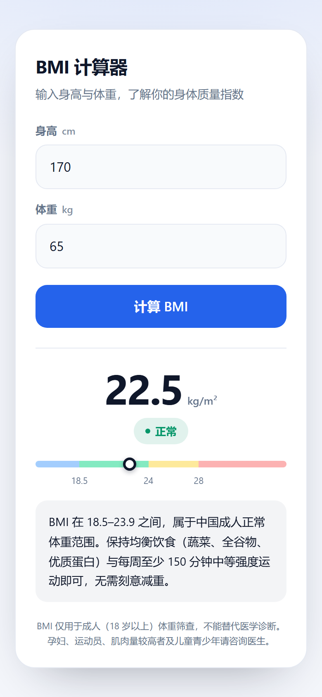

# BMI 计算器

输入身高与体重，按《中国成人超重和肥胖症预防控制指南》给出 BMI 分级与对应建议。纯静态单页，无构建步骤。



## 功能特性

- **即时计算**：身高 / 体重 → BMI，保留 1 位小数
- **分级提示**：偏瘦（<18.5）/ 正常（18.5–23.9）/ 超重（≥24，≥28 额外提示肥胖风险）
- **自适应界面**：深 / 浅色跟随系统，320px 起可用，不采集也不存储任何数据

## 技术栈

| 类别 | 使用 |
| --- | --- |
| 语言 / 运行时 | HTML + 内联 CSS / JavaScript，无运行时依赖 |
| 框架 / 库 | 无 |
| 数据 / 存储 | 无 |
| 部署 | GitHub Pages（分支 `main` 根目录） |

## 运行

直接双击 `index.html`，或起一个本地静态服务：

```bash
python -m http.server 8000
```

打开 <http://localhost:8000/>。

### 环境要求

- 任意现代浏览器（Chrome / Edge / Safari / Firefox）
- Python 3 仅用于本地预览，可选

## 项目结构

```
.
├── index.html    # 页面全部代码
├── preview.png   # 界面预览
└── README.md
```

## 许可证

[MIT](LICENSE)
